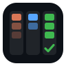

<div align="center">



<h1>suber-super-board</h1>

<p><strong>super-board, plus the three best skill sets, reaching every agent CLI.</strong></p>

<p>


</p>

</div>

A fork-superset of [EricTechPro/super-board](https://github.com/EricTechPro/super-board) —
the autonomous GitHub-Project loop where you add task cards to `Ready` and the board drains
itself into merged PRs with evidence: 8 skills (5 you type, 3 the board runs), six guard
hooks, one merge gate — extended here with:

1. **Three vendored skill sets** you can onboard with: [mattpocock/skills](https://github.com/mattpocock/skills),
   [pstack](https://github.com/michael-denyer/pstack-claude) (Lauren Tan's stack, Claude port),
   and [addyosmani/agent-skills](https://github.com/addyosmani/agent-skills) — all pinned copies
   in [`skill-sets/`](skill-sets/), no network needed at install time.
2. **A lifecycle map**: every set is mapped onto Plan · Design · Build · Test · Deploy · Maintain
   in [`skill-sets/registry.json`](skill-sets/registry.json); onboard writes the chosen mapping
   into your `AGENTS.md` and `.claude/super-board/skill-map.json`.
3. **Multi-agent install**: skills land in the agent-neutral `.agents/skills/`, and Claude,
   Codex, OpenCode, ZCode, Copilot or any other CLI gets the right wiring (see the matrix below).
4. **Onboard parameters**: pick the skill set and the agents as flags instead of wizard answers.

Everything upstream is unchanged otherwise — provenance and pins: [UPSTREAM.md](UPSTREAM.md).

## Install

One command, in your project folder:

```bash
curl -fsSL https://raw.githubusercontent.com/vuquangkhtn/suber-super-board/main/get.sh | bash
```

Flags (passed to `install.sh`): `--sets=mattpocock,pstack,agent-skills` (default: `mattpocock`),
`--hosts=claude,codex,copilot,zcode,other`, plus upstream's `--no-hooks`, `--protect-main`,
`--no-helper-skills`, `--target <dir>`, `--ref <tag>`.

Then onboard:

```
/super-board onboard                                   # interactive wizard
/super-board onboard --sets=pstack --agents=claude,codex
```

## The onboard wizard (10 steps)

Checks · **Skills** · **Agents** · GitHub · Board · Branch · AGENTS.md · Policies · Bug sources ·
Review. Enter takes the recommended answer; it resumes if interrupted.

- **🧩 Skills (step 2)** — pick one set: `mattpocock` (27 skills: grilling, specs, TDD, PRs,
  retros) / `pstack` (65: architect, arena, interrogate, blast-radius…) / `agent-skills` (25:
  spec-driven, security, shipping…) / **custom** — one question per lifecycle step
  (Plan / Design / Build / Test / Deploy / Maintain), each asking which set covers it. A step
  whose set has no skills (pstack → Maintain) falls back to the board's own loop.
- **🤖 Agents (step 3)** — multi-select which CLIs the skills must reach; installed CLIs are
  preselected. `claude` is always on; copilot and "other" agents get `AGENTS.md` pass-through notes.

## Skill-set → lifecycle mapping

Each set's default mapping (curated; pstack's comes straight from the
[pstack map](https://erictechpro.github.io/super-board/pstack/)) lives in
[`skill-sets/registry.json`](skill-sets/registry.json):

| Step | mattpocock | pstack | agent-skills |
|---|---|---|---|
| Plan | research, grilling, to-questionnaire, to-tickets, wayfinder | how, why, teach, figure-it-out, show-me-your-work | interview-me, idea-refine, spec-driven-development, constraint-driven-development, planning-and-task-breakdown |
| Design | codebase-design, domain-modeling, to-spec | architect, arena, interrogate | api-and-interface-design, frontend-ui-engineering |
| Build | implement, implement-spec, tdd, prototype, wizard | tdd, typescript-best-practices, deslop, no-comments | incremental-implementation, test-driven-development, context-engineering, source-driven-development, doubt-driven-development |
| Test | diagnosing-bugs, triage, wait-what, code-review | create-verification-skill, swarm, blast-radius, benchmark-checklist, interrogate, thermo-nuclear-code-quality-review | browser-testing-with-devtools, debugging-and-error-recovery, code-review-and-quality, security-and-hardening, performance-optimization, code-simplification |
| Deploy | pr, handoff | make-pr-easy-to-review, babysit, fix-merge-conflicts, get-pr-comments, fix-ci | git-workflow-and-versioning, ci-cd-and-automation, shipping-and-launch |
| Maintain | retro, teach, improve-codebase-architecture, writing-for-agents | — (super-board loop covers it) | deprecation-and-migration, documentation-and-adrs, observability-and-instrumentation |

Skill-name collisions across sets (e.g. `tdd` in mattpocock *and* pstack) install once — the
first set in your `--sets` list wins; the record in `.agents/skill-sets.json` notes the skips.

## Agent support

| Agent | How skills are reached |
|---|---|
| Claude Code | Board pack in `.claude/`; set skills symlinked `.claude/skills/<name>` → `.agents/skills/<name>` — slash commands work |
| Codex | reads `.agents/skills/` (symlinks followed); type `$skill-name` |
| OpenCode | reads `.agents/skills/` natively |
| ZCode | reads `.agents/skills/` natively |
| Copilot | no skill loader — the `AGENTS.md` skill-map block maps each step to its skills |
| other | same pass-through as Copilot; name it in onboard's "Other" box |

## The board itself

Unchanged from upstream: `/super-board run <slug>` plans waves, runs the Build → QA → Review
lanes (worktrees, draft PRs, evidence, merge gate with `verify_commands`), six guard hooks,
`/super-collect` for Sentry/PostHog/issues/PRs, `/ui-refine-loop`, `/visual`, `/git-sync`.
See upstream's docs in `docs/` and `skills/*/README.md`. Its own 8 skills (5 you type, 3 the board runs):

<!-- skills:start -->
**You type — 5 skills**

| Skill | What it does |
|---|---|
| [`/super-board`](skills/super-board/README.md) | Orchestrator: plans waves, runs Build → QA → Review, merges when green. |
| [`/super-collect`](skills/super-collect/README.md) | Finds problems (Sentry, PostHog, issues, PRs, architecture) and files verified Backlog cards. |
| [`/ui-refine-loop`](skills/ui-refine-loop/README.md) | Critique → refine loop that polishes one page or component. |
| [`/visual`](skills/visual/README.md) | One HTML page: branch recap, plan, or codebase map with diagrams. |
| [`/git-sync`](skills/git-sync/README.md) | Commit per logical change, merge-pull, push without force, report. |

**The board runs — 3 lanes**

| Skill | What it does |
|---|---|
| [`/super-build`](skills/super-build/README.md) | Builder lane: worktree, smallest safe change, tests, draft PR. |
| [`/super-qa`](skills/super-qa/README.md) | Tester lane: evidence, test-gap check, screenshots, or bounce to Build. |
| [`/super-review`](skills/super-review/README.md) | Reviewer lane: own hypotheses, remembers prior findings, merge gate. |
<!-- skills:end -->

Each name links to that skill's README. Adding a skill? Write its `SKILL.md` and `README.md`,
add a line to `skills/families.json`, and this table updates itself.

## Credits

- [EricTechPro/super-board](https://github.com/EricTechPro/super-board) v3.1.2 (MIT © Eric Tech) — the board. Merged with full history; sync via the `upstream` remote.
- [mattpocock/skills](https://github.com/mattpocock/skills) (MIT) — 27 skills.
- [pstack](https://github.com/cursor/plugins/tree/main/pstack) by Lauren Tan (MIT) and its port [pstack-claude](https://github.com/michael-denyer/pstack-claude) (MIT © Michael Denyer) — 66 skills; NOTICE files preserved.
- [addyosmani/agent-skills](https://github.com/addyosmani/agent-skills) (MIT © Addy Osmani) — 25 skills + shared checklists.

All licenses: [LICENSE](LICENSE) (upstream) and [skill-sets/](skill-sets/); pins and notices: [UPSTREAM.md](UPSTREAM.md).
